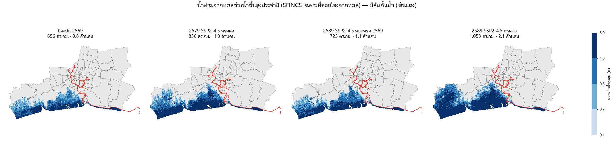
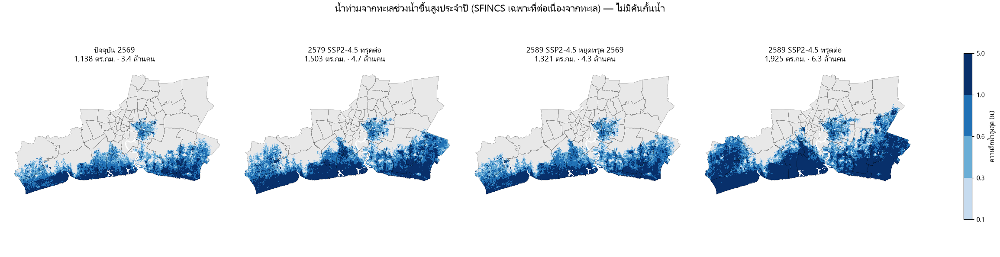

# น้ำท่วมจากทะเลด้วยแบบจำลองชลศาสตร์ SFINCS: ผลของการทรุดเทียบระดับน้ำทะเลที่สูงขึ้น (10 และ 20 ปีข้างหน้า)

สคริปต์: `scripts/sfincs_flood.py` (build-base) → `scripts/sf_rate.py` (อัตราทรุดเติมช่องว่าง) → `scripts/sf_setup.py` (ไฟล์นำเข้า) → รัน SFINCS → `scripts/sf_post.py` (hmax, ชั้นเว็บ) → `scripts/sf_finish.py` (ตาราง รูป meta) · ผล: `results/sfincs/` · เว็บ: ปุ่ม "น้ำทะเล"

## วิธีทำ
| ส่วน | รายละเอียด |
|---|---|
| แบบจำลอง | SFINCS v2.5.0 (Leijnse et al. 2021, Deltares) Docker `deltares/sfincs-cpu:sfincs-v2.5.0-Hautacam` สมการน้ำตื้นแบบลดรูป (local inertia) ไม่คิด advection รันทั้ง 18 รอบพร้อมกันบน GitHub Actions (branch `sfincs-runs`) ผลตรงกับการรันบนเครื่องด้วยซอร์สเวอร์ชันเดียวกันทุกช่อง |
| กริด | UTM 47N 100 ม. 1,110 × 700 ช่อง (ใช้งาน 541,643 ช่อง) ครอบสามจังหวัด + 3 กม. รอบ + อ่าวไทยตอนบน |
| ภูมิประเทศ | DeltaDTM v1.1 เฉลี่ย 100 ม. − 1.08 ม. (MSL เหนือ EGM2008 จาก DTU21) − อัตราทรุด × (ปี − 2020) ทะเล −2 ม., แม่น้ำเจ้าพระยา (Overture) −6 ม. อัตราทรุดในสามจังหวัดใช้พื้นผิวที่เติมช่องว่างด้วยสิ่งปกคลุมดิน (`docs/gap_fill.md`) |
| ความขรุขระ | Manning บนบก 0.06 ทะเล 0.025 |
| แรงขับที่ขอบทะเล | ระดับน้ำทั้งหมด (น้ำขึ้นลง + คลื่นพายุ) จาก GTSM reanalysis v3 ทุก 10 นาที 10 จุดในอ่าวไทยตอนบน ช่วง 22–26 มิ.ย. 2567 (ยอดน้ำสูงสุดของปี +2.0 ม. ที่ปากแม่น้ำ วันที่ 24) spin-up 1 วัน |
| ระดับน้ำทะเลในอนาคต | บวกค่ากลาง IPCC AR6 (novlm) ที่ป้อมพระจุลฯ เทียบปี 2567: 2036 +0.055 / +0.067 ม., 2046 +0.111 / +0.135 ม. (SSP2-4.5 / SSP5-8.5) |
| คันกั้นน้ำ (กรณีมีคัน) | weir: ตลิ่งเจ้าพระยาสองฝั่ง 223 กม. สันคัน +2.80 ม. MSL (ค่าออกแบบ กทม.), แนวถนนสุขุมวิทชายฝั่งสมุทรปราการ +2.50 ม. (สมมติ) ทรุดลงตามอัตราทรุดในกรณีทรุดต่อ |
| ท่วม | ความลึกสูงสุด > 10 ซม. บนแผ่นดินในสามจังหวัด **และต่อเนื่องถึงทะเลผ่านช่องที่ท่วม (8 ทิศ) หรือช่องทะเล** แอ่งที่ท่วมแยกในแผ่นดินหรือเชื่อมทะเลผ่านร่องแม่น้ำเท่านั้นไม่นับ (`sf_common.coastal`) |

ชุดการรัน 18 รอบ: ปัจจุบัน 2569 (2 รอบ) + ปี 2579/2589 (10 และ 20 ปีข้างหน้า) × SSP2-4.5/SSP5-8.5 × ทรุดต่อ/หยุดทรุดปี 2569 × มีคัน/ไม่มีคัน

บนเว็บ บ่อ คลอง และแม่น้ำที่อยู่ภายในแนวน้ำท่วม (ไม่เกิน 500 ม. จากช่องที่ท่วม) ระบายสีตามความลึกของช่องที่ท่วมใกล้สุด เพื่อไม่ให้แนวน้ำท่วมเป็นรู (`sf_common.display`) ตัวเลขในตารางนับเฉพาะแผ่นดิน

## ผล: น้ำท่วมจากทะเลช่วงน้ำขึ้นสูงประจำปี

| ฉากทัศน์ | คันกั้นน้ำ | การทรุด | น้ำทะเลเพิ่ม (ม.) | พื้นที่ท่วม (ตร.กม.) | ประชากร (ล้าน) | อาคาร (พัน) | โรงเรียน | โรงพยาบาล |
|---|---|---|---|---|---|---|---|---|
| ปัจจุบัน 2569 | มี | – | 0.000 | 656 | 0.8 | 260 | 80 | 5 |
| 2579 SSP2-4.5 | มี | ทรุดต่อ | 0.055 | 836 | 1.3 | 373 | 100 | 6 |
| 2579 SSP2-4.5 | มี | หยุดทรุด 2569 | 0.055 | 688 | 1.0 | 286 | 84 | 5 |
| 2579 SSP5-8.5 | มี | ทรุดต่อ | 0.067 | 846 | 1.3 | 380 | 101 | 6 |
| 2579 SSP5-8.5 | มี | หยุดทรุด 2569 | 0.067 | 695 | 1.0 | 292 | 84 | 5 |
| 2589 SSP2-4.5 | มี | ทรุดต่อ | 0.111 | 1,053 | 2.1 | 554 | 138 | 11 |
| 2589 SSP2-4.5 | มี | หยุดทรุด 2569 | 0.111 | 723 | 1.1 | 315 | 90 | 6 |
| 2589 SSP5-8.5 | มี | ทรุดต่อ | 0.135 | 1,073 | 2.2 | 573 | 141 | 12 |
| 2589 SSP5-8.5 | มี | หยุดทรุด 2569 | 0.135 | 739 | 1.2 | 328 | 94 | 6 |
| ปัจจุบัน 2569 | ไม่มี | – | 0.000 | 1,138 | 3.4 | 688 | 153 | 10 |
| 2579 SSP2-4.5 | ไม่มี | ทรุดต่อ | 0.055 | 1,503 | 4.7 | 968 | 206 | 13 |
| 2579 SSP2-4.5 | ไม่มี | หยุดทรุด 2569 | 0.055 | 1,228 | 3.8 | 776 | 164 | 12 |
| 2579 SSP5-8.5 | ไม่มี | ทรุดต่อ | 0.067 | 1,521 | 4.8 | 986 | 208 | 14 |
| 2579 SSP5-8.5 | ไม่มี | หยุดทรุด 2569 | 0.067 | 1,247 | 3.9 | 795 | 166 | 12 |
| 2589 SSP2-4.5 | ไม่มี | ทรุดต่อ | 0.111 | 1,925 | 6.3 | 1,288 | 274 | 23 |
| 2589 SSP2-4.5 | ไม่มี | หยุดทรุด 2569 | 0.111 | 1,321 | 4.3 | 869 | 182 | 13 |
| 2589 SSP5-8.5 | ไม่มี | ทรุดต่อ | 0.135 | 1,960 | 6.5 | 1,324 | 277 | 24 |
| 2589 SSP5-8.5 | ไม่มี | หยุดทรุด 2569 | 0.135 | 1,359 | 4.5 | 905 | 196 | 13 |

**เขต/อำเภอที่ท่วมมากที่สุด (% ของพื้นที่, SSP2-4.5 มีคัน ถ้าไม่ระบุ)**

| เขต/อำเภอ | จังหวัด | ปัจจุบัน | 2579 ทรุดต่อ | 2589 หยุดทรุด | 2589 ทรุดต่อ | 2589 SSP5-8.5 ทรุดต่อ ไม่มีคัน |
|---|---|---|---|---|---|---|
| บางขุนเทียน | กรุงเทพมหานคร | 68% | 82% | 75% | 98% | 98% |
| บ้านแพ้ว | สมุทรสาคร | 29% | 65% | 38% | 96% | 97% |
| พระสมุทรเจดีย์ | สมุทรปราการ | 89% | 92% | 91% | 95% | 98% |
| ทุ่งครุ | กรุงเทพมหานคร | 57% | 76% | 69% | 93% | 93% |
| เมืองสมุทรสาคร | สมุทรสาคร | 68% | 78% | 73% | 87% | 87% |
| จอมทอง | กรุงเทพมหานคร | 3% | 30% | 14% | 57% | 75% |
| ราษฎร์บูรณะ | กรุงเทพมหานคร | 0% | 7% | 0% | 42% | 43% |
| บางบอน | กรุงเทพมหานคร | 0% | 1% | 0% | 40% | 42% |
| พระประแดง | สมุทรปราการ | 4% | 10% | 7% | 19% | 27% |
| เมืองสมุทรปราการ | สมุทรปราการ | 12% | 14% | 14% | 17% | 98% |
| กระทุ่มแบน | สมุทรสาคร | 0% | 0% | 0% | 13% | 16% |
| บางบ่อ | สมุทรปราการ | 8% | 8% | 8% | 11% | 100% |

## ตรวจความต่อเนื่องของแนวน้ำท่วมชายฝั่ง
- ช่องแผ่นดินที่ติดทะเลทั้งแนว (ราว 80 กม. จากสมุทรสาครถึงสมุทรปราการ) ท่วม 100% ในทั้ง 18 รอบ
- น้ำท่วมที่เหลือเป็นแนวเดียวสองฝั่งของร่องแม่น้ำเจ้าพระยา (ชิ้นเล็กอื่นรวม 0.04 ตร.กม.)
- แอ่งในแผ่นดินที่ตัดออก (เช่น หนองจอก ลาดกระบัง/สุวรรณภูมิ บางกรวย ดอนเมือง): 7–10 ตร.กม. ในกรณีมีคัน และ 46–54 ตร.กม. ในกรณีไม่มีคัน (คอลัมน์ `inland_patches_removed_km2` ใน `flood_summary.csv`)

## ข้อค้นพบหลัก
- **ปัจจุบัน** น้ำขึ้นสูงประจำปีท่วมพื้นที่ชายฝั่ง 656 ตร.กม. แม้มีคัน (ส่วนใหญ่เป็นชายฝั่งสมุทรสาครและบางขุนเทียนที่ไม่มีคัน ซึ่งเป็นบ่อเลี้ยงสัตว์น้ำและป่าชายเลน) ถ้าไม่มีคันจะท่วม 1,138 ตร.กม.
- **อีก 10 ปี (2579, SSP2-4.5, มีคัน)**: ทรุดต่อ 836 ตร.กม. / 1.3 ล้านคน เทียบหยุดทรุด 688 ตร.กม. / 1.0 ล้านคน
- **อีก 20 ปี (2589, SSP2-4.5, มีคัน)**: ทรุดต่อ 1,053 ตร.กม. / 2.1 ล้านคน เทียบหยุดทรุด 723 ตร.กม. / 1.1 ล้านคน
- ในช่วง 10–20 ปีนี้ SSP2-4.5 กับ SSP5-8.5 ต่างกันแค่ 1–2 ซม. ของระดับน้ำทะเล และ 10–35 ตร.กม. ของพื้นที่ท่วม ขณะที่การทรุดต่อหรือหยุดทรุดต่างกัน 150–600 ตร.กม.
  **การทรุดเป็นตัวแปรที่ใหญ่กว่าฉากทัศน์ภูมิอากาศมากในอีก 20 ปีข้างหน้า**
- กรณีไม่มีคัน ปี 2589 SSP5-8.5 ทรุดต่อ น้ำเข้าถึงเมืองสมุทรปราการและบางบ่อเกือบทั้งอำเภอ แสดงว่าแนวถนนสุขุมวิทชายฝั่งเป็นตัวกั้นสำคัญ

## ข้อจำกัด
- แนวคันและความสูงสันคันเป็นค่าประมาณ (ไม่มีข้อมูลเปิดของแนวคัน) ไม่มีคันพระราชดำริ คันริมแม่น้ำท่าจีน และประตูระบายน้ำในคลองต่าง ๆ
- ไม่รวมฝน น้ำเหนือ การระบายและสูบน้ำ ผลเป็นน้ำท่วมจากทะเลช่วงน้ำขึ้นไม่กี่วัน ไม่ใช่น้ำขังระยะยาว
- DEM คลาดได้ ~0.45 ม. และกริด 100 ม. ไม่เห็นคันดินเล็ก ถนนยกระดับ และอาคาร
- ใช้เหตุการณ์น้ำขึ้นสูงปี 2567 เหตุการณ์เดียว และอัตราทรุดคงที่ (ทางตะวันออกอาจทรุดเกินจริง 3–6 มม./ปี ดู `docs/full_method.md`) อัตราทรุดในช่องที่ InSAR วัดไม่ได้เป็นค่าประมาณ (`docs/gap_fill.md`)
- ประชากรจาก WorldPop 2025 คงที่ ไม่ได้คาดการณ์การเปลี่ยนแปลงของประชากร
- ใช้ผลเพื่อเปรียบเทียบฉากทัศน์ ไม่ใช่การพยากรณ์น้ำท่วมรายจุด

## ไฟล์
`hmax_<รอบ>.tif` (ความลึกน้ำสูงสุด ม., UTM 47N 100 ม., ทุกช่องที่แบบจำลองคำนวณ ยังไม่ได้ตัดแอ่งในแผ่นดิน), `flood_summary.csv`, `flood_districts.csv`, `flood_maps_def.png`, `flood_maps_undef.png`
ข้อมูลนำเข้า: `data/sfincs/` (กริดฐาน อัตราทรุด แนวคัน แม่น้ำ ระดับน้ำขอบเขต)
